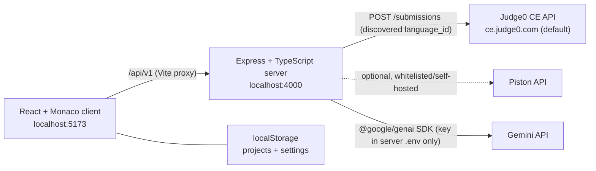

# PolyCompile Pro

A universal online compiler: write code in 13 languages in one Monaco editor, run it through a real code-execution provider (Judge0 CE by default — see the provider note below) via a local Node backend, visualize real compiler phases for JavaScript/TypeScript, and use Gemini-powered AI tools (error explanation, code explanation, conversion, complexity, flowcharts) — with honest status everywhere: nothing is simulated, and unverified features say so.

## Architecture



The frontend **never** calls Piston or Gemini directly, and no API key ever reaches the browser. User code is **never executed** in the Express process (no eval, no Function, no shell) — it only runs inside the provider's sandbox.

## Folder structure

```
polycompile-pro/
  client/   React + TS + Vite + Tailwind + Monaco (src/components, src/lib)
  server/   Express + TS (src/routes, src/services/execution, src/services/gemini, src/middleware, src/config)
  shared/   Language registry + Zod schemas + types used by both sides
  legacy/   The original single-file prototype, preserved
  docs/     Audit, final report
  tests/    (package-level tests live beside the code: server/src/*.test.ts, client/src/lib/*.test.ts)
```

## Prerequisites
- Node.js LTS (20+; built/tested here on Node 24)
- Internet access for code execution (Piston) and AI (Gemini). **This app is not fully offline** — the UI and backend run locally, execution and AI do not.

## Windows setup (PowerShell)

```powershell
# 1. Install Node.js LTS from https://nodejs.org, then in this folder:
npm install
# 2. Configure the environment:
Copy-Item .env.example .env
notepad .env   # set GEMINI_API_KEY from Google AI Studio: https://aistudio.google.com/apikey
# 3. Run (builds shared contracts, then starts server :4000 and client :5173):
npm run dev
# 4. Open http://localhost:5173 and check the header shows "Backend connected".
```

Judge0's public CE instance needs no key (`EXECUTION_API_KEY` stays empty).

> **Provider note (verified live, 2026-10-28):** the public Piston API became **whitelist-only on 2026-02-15** — `GET /runtimes` still responds, but `POST /execute` returns HTTP 401 for non-whitelisted callers. PolyCompile Pro therefore defaults to Judge0 CE, whose public instance executed real submissions in testing. The Piston adapter is still included (`EXECUTION_PROVIDER=piston` + `EXECUTION_API_URL`) for whitelisted or self-hosted Piston instances; language runtimes are discovered from whichever provider is configured. Gemini is optional: without a key, every AI button returns a clear "AI not configured" message and the rest of the app works normally. Gemini usage may have quotas/charges depending on your Google account/plan. Get a key only from the official Google AI Studio link above.

## Commands
| Command | What it does |
|---|---|
| `npm run dev` | Build shared, run server (watch) + client together |
| `npm run build` | Build shared, server (tsc) and client (vite) for production |
| `npm run typecheck` | Type-check server + client |
| `npm test` | Unit tests (external providers mocked) |
| `npm run test:integration -w @polycompile/server` | **Real** Piston tests (needs internet) |

## Environment variables (`.env.example`)
`PORT`, `CLIENT_ORIGIN`, `EXECUTION_PROVIDER` (only `piston` implemented), `EXECUTION_API_URL`, `EXECUTION_API_KEY` (unused by public Piston), `GEMINI_API_KEY`, `GEMINI_MODEL` (default `gemini-flash-latest`), `EXECUTION_TIMEOUT_MS` (default 90000 — the free public provider queues submissions and compiled languages can take tens of seconds; the Stop button cancels), `MAX_SOURCE_BYTES`, `MAX_STDIN_BYTES`, `MAX_OUTPUT_BYTES`.

## Languages
The registry in `shared/src/languages.ts` lists all 13 languages with both providers' mappings, discovered live: Piston runtime name/version from `GET /runtimes`, and Judge0 `language_id` + name from `GET /languages` on ce.judge0.com. The server re-discovers runtimes at runtime and the UI chips show the actually-resolved version; a language whose runtime disappears is flagged, not silently claimed. Verified per-language smoke-test results are in `docs/FINAL-REPORT.md` — read them before claiming any language works.

Limitations to know: Java's main class must be `Main`; with the default Judge0 provider only a **single file** is executed (extra files are rejected with a clear error, never silently dropped) — multi-file uses Piston semantics (first file = entry point) and needs a whitelisted/self-hosted Piston instance; C# uses a Mono runtime on both providers.

## Compiler visualizer — what is real
- **Lexical analysis:** a real scanner producing tokens with line/column positions (all languages show tokens; capped for display).
- **Parsing:** for JavaScript/TypeScript only, a genuine AST from the **TypeScript compiler API**, with real parse diagnostics.
- **IR:** a documented three-address-style transformation for a *limited subset* of top-level JS/TS statements, labeled "conceptual" in the UI.
- **Everything else:** an explicit "not implemented for this language" message. Python shows tokens only (no bundled Python AST parser).

## AI features
`POST /api/v1/ai/explain-error | explain-code | convert | complexity | flowchart`, all backend-mediated via the official `@google/genai` SDK, schema-validated, rate-limited, click-triggered only. Conversions and complexity are labeled AI-generated and **not verified**; the UI invites you to run converted code and compare outputs. Flowchart JSON is validated against a Zod node/edge schema before rendering (rendered as text/DOM, never raw HTML).

## Security model
Zod validation on every endpoint; CORS allowlist for local origins; per-IP rate limits (60/min execute, 20/min AI); source/stdin/output size caps; upstream timeouts + client-cancellation propagation; concurrency cap (3); provider output treated as text, never HTML; structured logs that never include source code or secrets (redaction helper tested); `.env` git-ignored.

## Troubleshooting
- Header says "Backend unreachable": the server isn't running — use root `npm run dev`, or check `http://localhost:4000/api/v1/health`.
- Run returns PROVIDER_UNAVAILABLE / PROVIDER_RATE_LIMITED: no internet, or the provider is down/rate-limiting (public instances have limits — wait and retry). If you switched to Piston and get PROVIDER_AUTH_REQUIRED, that instance is not whitelisted (see provider note).
- AI returns AI_NOT_CONFIGURED: set `GEMINI_API_KEY` in `.env` and restart.
- Java error about class name: your public class must be `Main` in `Main.java`.

## Known limitations & future work
See `docs/FINAL-REPORT.md` (limitations + prioritized next steps). Short version: no accounts/cloud sync (browser storage only), no self-hosted sandbox, visualizer is JS/TS-only, formatting only works for JS/TS (Monaco limitation, reported honestly in-app).
## Sharing safely

Keep development tunnels private by default. `npm run dev` serves readable source modules and exposes the local API proxy; it is not a public deployment mode. If a tunnel is made public, anonymous visitors can discover the UI and may consume execution/provider quota unless `DEMO_ACCESS_TOKEN` is configured. Set that token in the server environment and send it as `Authorization: Bearer <token>` for execution and AI requests. Never commit `.env` or paste a Gemini key into chat. For public sharing, build the client and serve the production output behind an HTTPS reverse proxy with the token gate enabled.

The server health endpoint intentionally returns only `ok` and `service` by default. Set `EXPOSE_DIAGNOSTICS=true` only on a private local instance when detailed provider diagnostics are needed.
